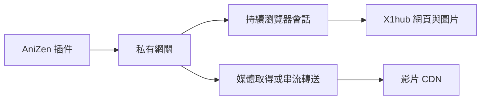

# X1hub：FlareSolverr 與 Scrapling 方案評估

評估日期：2026-11-06。插件程式基準為 [X1hub 16.3](https://github.com/Supebuff/sb-extensions-source/commit/ef9f42e42a07434e99607a7446eda3c9f31754cb)，宿主為 AniZen 0.5.220。使用者選擇先比較，再決定是否採用額外服務；本次不增加正式插件依賴、設定或版號，也未部署常駐服務。

## 新日誌代表什麼

- 10:37:39～10:37:45，`RealImageLoader` 記錄 30 次「無法繞過 Cloudflare」及 `CloudflareBypassException`，圖片主機均為 `www.x1hub.com`。
- 本份未見 `Fatal signal`、`FATAL EXCEPTION` 或 MPV 播放錯誤；不能以此認定播放已恢復。日誌也未列出插件版號，不能獨立確認測試時安裝的是哪一版。
- 現行遠端縮圖由 App 載入，不經 X1hub 頁面請求的間隔／冷卻 policy。因此只替頁面解析加入 solver，不能直接涵蓋這批圖片錯誤。
- 多次失敗值得追查同一主機的驗證是否重複進行，但本份缺少 solver 生命週期紀錄，尚未證明 Cookie 競爭或多個 WebView 就是原因。

原始手機日誌、Cookie、影片標題及帶權杖媒體網址不放入倉庫。

## 兩個工具如何適用

| 項目 | FlareSolverr | Scrapling |
| --- | --- | --- |
| 定位 | 已提供 HTTP JSON API 的瀏覽器解頁服務 | Python 擷取與瀏覽器自動化框架，需自行包裝服務 |
| 瀏覽器 | Chrome／Selenium／undetected-chromedriver | StealthySession 使用 Chrome／Chromium 與瀏覽器自動化元件 |
| 會話 | `sessions.create`／`sessions.destroy` 可重用瀏覽器 | 持續 session、分頁上限、請求觀察與自訂操作 |
| 直接整合 Kotlin APK | 非現有 Gradle／Android 依賴；需獨立執行環境 | Python 加瀏覽器環境，不能直接當成目前 APK 的函式庫 |
| 最快用途 | 先驗證服務端是否能自動取得受保護 HTML | 網站診斷、觀察播放請求、開發圖片／媒體專用網關 |
| 圖片／影片 | 現有 `request.get` 回傳 HTML／Cookie，不是通用二進位／Range 串流代理 | 可自訂流程，但仍需開發與驗證圖片轉送、影片 Range 及到期刷新 |
| 完全免操作 | 必須以本站真實挑戰測試，不能保證 | `solve_cloudflare=True` 是功能選項，不等同本站成功率證據 |

依據：[FlareSolverr README](https://github.com/FlareSolverr/FlareSolverr/blob/cc2224b21e31c09a713eb25690a8e8dcdf50d8d8/README.md)、[服務端實作](https://github.com/FlareSolverr/FlareSolverr/blob/cc2224b21e31c09a713eb25690a8e8dcdf50d8d8/src/flaresolverr_service.py)、[Scrapling README](https://github.com/D4Vinci/Scrapling/blob/bc602488b44e978da3266841e913af17577ec0fd/README.md)及[瀏覽器文件](https://github.com/D4Vinci/Scrapling/blob/bc602488b44e978da3266841e913af17577ec0fd/docs/fetching/stealthy.md)。

FlareSolverr 的 `request.get` 實作使用 `driver.page_source`；不能把服務的 8191 連接埠直接當成 AniZen 的一般影片代理。Scrapling 0.5.1 需要 Python 3.10 以上，瀏覽器相關套件在 `fetchers` 額外依賴中，見 [pyproject.toml](https://github.com/D4Vinci/Scrapling/blob/bc602488b44e978da3266841e913af17577ec0fd/pyproject.toml)。

## 不能只把電腦 Cookie 複製到手機

Cloudflare 說明 `cf_clearance` 與特定訪客及裝置綁定；FlareSolverr 也要求後續使用其 User-Agent。伺服器取得 Cookie，不代表手機的 OkHttp、MPV 或外部播放器一定能使用，尤其切換網路後不能作此保證。[Cloudflare clearance](https://developers.cloudflare.com/cloudflare-challenges/concepts/clearance/)、[FlareSolverr request.get](https://github.com/FlareSolverr/FlareSolverr/blob/cc2224b21e31c09a713eb25690a8e8dcdf50d8d8/README.md#-requestget)

這是設計限制，不代表已證實本次 MP4／TLS 故障由跨裝置 Cookie 造成。相同 UA 也不是所有瀏覽器指紋訊號都相同。

若採用常駐服務，應先在服務端保留瀏覽器會話，再驗證後續受保護請求由同一服務取得資料的效果。若回傳的 CDN 連結不能由手機直接使用，媒體也需經服務轉送；僅回傳 Cookie 的方案不能當成已完成。

## 服務方案草案（尚未實作）

- 頁面：網關經瀏覽器取得列表／詳情／播放資訊，插件沿用既有解析。
- 縮圖：回傳可經網關載入的圖片網址或受控快取，避免 App 仍直接請求原站而再次驗證。
- 媒體：先測試 CDN 網址能否由手機使用；必要時轉送影片並正確處理 `Range`、`206`、`Content-Range`、串流取消及連結到期。
- 會話：同一使用者／主機共用有效會話，限制解驗證與圖片並行，避免每張圖片都另開瀏覽器；失敗與 429 冷卻需有上限，不無限重試。
- 連線：手機在行動數據下也必須能連到網關。FlareSolverr 建議不要直接公開其 API；可經私有網路或有存取控制的網關提供服務。驗證 Cookie、服務密鑰與完整媒體權杖不寫入日誌。

維持服務端出口可減少手機換網路對來源會話的直接影響，但手機到服務的重連與播放器續播仍要實測，不能預先保證無感。影片若經網關轉送，電腦／NAS 必須在線，並承擔影片流量。

## 本次實測與限制

| 項目 | 結果 |
| --- | --- |
| 測試環境 | 工作區內獨立 Python 3.12 venv，Scrapling 0.5.1，已安裝的 Chrome，獨立暫存 profile |
| 重要選項 | `headless=True`、`real_chrome=True`、`solve_cloudflare=True`、`max_pages=1`、`google_search=False`、`disable_resources=False` |
| 最新列表 | HTTP 200，24 筆 |
| 一張影片縮圖 | 由同一瀏覽器會話的 fetch 取得；限定本站 `/contents/videos…`，HTTP 200、image/jpeg、3512 bytes |
| 單次耗時 | 首輪約 9.7 秒，加入縮圖路徑確認後約 7.4 秒；不是效能基準 |
| 挑戰觀察 | 兩輪均未觀察到 `cf-mitigated: challenge`，沒有真實挑戰被成功解開的證據 |
| FlareSolverr | 已核對官方文件與程式；未安裝／未進行本站實測，不能比較成功率 |
| Android | 未驗證從手機使用外部服務、Cookie 移轉、圖片整批載入或影片播放 |

本次測試證明 Scrapling 的隔離瀏覽器流程能存取當時本站列表與一張縮圖，**未證明能解除手機遇到的 Cloudflare 驗證**。Chrome 可播放、HTTP 200 或成功取得 HTML，都不能取代 AniZen 實際播放與切網路驗證。

測試程式與套件只在工作區的 `scratch/` 隔離環境，未接入正式插件，也沒有啟動常駐或對外 API。插件仍為 16.3。

## 採用順序建議

1. 若接受電腦／NAS 常駐：先做小型外部網關驗證。需要自訂圖片與影片轉送時，優先評估 Scrapling；若已有 FlareSolverr，先重用其 HTML／會話 API 亦可。
2. 先取得一次「本站真的提出挑戰，且服務自動解開」的紀錄，再測列表與整批縮圖；不能以本次沒有挑戰的 200 回應當作 solver 已通過。
3. 再確認手機端播放、Range 拖曳、畫質切換、下載、切網路與到期恢復；服務中斷也要明確回報，不能偽裝成空列表。
4. 若希望只靠手機：優先檢查同主機驗證共用、縮圖節流／快取及宿主的 WebView 流程。這能減少重複請求，但不保證所有互動驗證免操作，亦不是把 Python 工具塞進插件即可完成。

目前維持「先比較、再決定」，不預設使用者接受常駐電腦、媒體轉送或額外服務維運。
